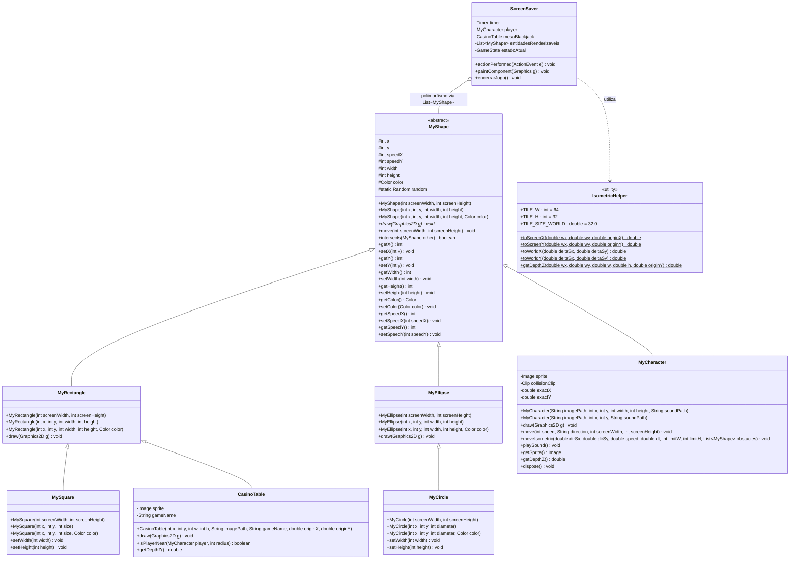

# Arquitetura de referência

Implementação da Etapa 1 concluída para a hierarquia de formas geométricas do pacote `model`.



## Decisões de Implementação

### 1. Inicialização Aleatória (`MyShape(screenWidth, screenHeight)`):
- Dimensões geradas aleatoriamente entre 20 e até 1/5 da menor dimensão da tela.
- Posição `(x, y)` contida no intervalo visível `[0, screenWidth - width]` e `[0, screenHeight - height]`.
- Velocidades `speedX` e `speedY` sorteadas entre -4 e 4 (evitando repouso simultâneo em ambos os eixos).
- Cores sorteadas com componentes RGB inteiros no intervalo [0, 255].
- `MySquare` e `MyCircle` harmonizam largura e altura para o menor valor sorteado pela superclasse, preservando proporções 1:1.

### 2. Detecção de Colisão em Bordas Tangentes (`intersects`):
- Foi adotado o critério estrito de sobreposição de área (`<` e `>`):
  ```java
  this.x < other.x + other.width &&
  this.x + this.width > other.x &&
  this.y < other.y + other.height &&
  this.y + this.height > other.y
  ```
- Quando duas formas apenas encostam suas bordas externas sem se sobrepor (ex.: `x1 + w1 == x2`), a área de interseção é zero e `intersects` retorna `false`.

### 3. Invariantes e Chamadas no Construtor:
- Para evitar invocar métodos sobrescrevíveis (`setWidth` / `setHeight`) dentro do construtor da superclasse `MyShape`, a validação de dimensões estritamente positivas é realizada de forma direta/estática no momento da instanciação.

## Arquitetura do Cassino Social Isométrico

### 1. Projeção Isométrica 2:1 e Transformação Inversa
- **Espaço de Mundo:** coordenadas contínuas cartesianas no plano do chão $(worldX, worldY)$. Escala: $1 \text{ tile} = 32 \text{ pixels de mundo}$ ($TILE\_SIZE\_WORLD = 32.0$).
- **Espaço de Tela:** losangos isométricos com largura $TILE\_W = 64$ e altura $TILE\_H = 32$ (proporção 2:1 exata, $TILE\_W = 2 \times TILE\_H$).
- **Equações Diretas (Mundo -> Tela):**
  $$\text{tileX} = \frac{worldX}{32.0}, \quad \text{tileY} = \frac{worldY}{32.0}$$
  $$\text{screenX} = (\text{tileX} - \text{tileY}) \times \frac{TILE\_W}{2} + \text{originX} = (worldX - worldY) + \text{originX}$$
  $$\text{screenY} = (\text{tileX} + \text{tileY}) \times \frac{TILE\_H}{2} + \text{originY} = \frac{worldX + worldY}{2} + \text{originY}$$
- **Equações Inversas (Tela -> Mundo):**
  Dado $\Delta \text{screenX} = \text{screenX} - \text{originX}$ e $\Delta \text{screenY} = \text{screenY} - \text{originY}$:
  $$worldX = \Delta \text{screenY} + \frac{\Delta \text{screenX}}{2}$$
  $$worldY = \Delta \text{screenY} - \frac{\Delta \text{screenX}}{2}$$
- Testado e comprovado matematicamente com erro $< 10^{-6}$.

### 2. Separação Semântica: Footprint vs Dimensões do Sprite
- `MyShape` define os atributos `x, y, width, height`.
- No jogo isométrico, esses valores representam a **base física sólida no chão (footprint)**:
  - Avatar: footprint compacto de $24 \times 24$ pixels nos pés.
  - Mesa: footprint de $80 \times 50$ pixels nos pés da mesa.
- O sprite visual (`Image sprite`) possui dimensões próprias (ex.: $48 \times 72$ no avatar). Ao desenhar, a sola dos pés do sprite é ancorada no centro do footprint projetado no chão. Isso impede ambiguidade conceitual e permite ao avatar caminhar atrás de mesas altas sem esbarrar no ar.

### 3. Normalização de Vetor e Velocidade Constante
- Ao pressionar teclas diagonais simultâneas (ex.: W + D), o vetor visual de tela $(\pm 1, \pm 1)$ é normalizado para módulo unitário $1.0$ ($\frac{1}{\sqrt{2}}$ em cada eixo).
- Esse vetor normalizado é convertido para o plano do mundo via transformação inversa, garantindo que o avatar se mova com velocidade escalar rigorosamente constante na tela, sem aceleração excessiva em diagonais.
- A posição é mantida em acumuladores fracionários (`double exactX, exactY`), sincronizados com `this.x = (int) Math.round(exactX)` para compatibilidade total com as assinaturas da superclasse `MyShape`.

### 4. Colisão por Eixos no Plano do Mundo (Deslizamento)
- A movimentação testa o deslocamento separadamente no eixo X e no eixo Y do mundo.
- Em cada eixo, uma caixa de teste `MyRectangle` verifica `intersects(obstaculo)` e os limites do salão com o footprint completo.
- Se o eixo X estiver bloqueado mas o Y estiver livre (ou vice-versa), o avatar avança no eixo desobstruído, gerando um deslizamento suave ao longo de paredes e mobílias.

### 5. Ordenação de Profundidade (*Z-Sorting*)
- Ponto de apoio: centro da base do footprint no solo $(x + w/2, y + h/2)$.
- A profundidade visual $Z$ corresponde ao $\text{screenY}$ desse ponto de apoio.
- Antes da renderização de cada quadro, a coleção `List<MyShape>` é ordenada crescentemente por esse valor. Objetos ao norte (mais ao fundo) são desenhados primeiro; objetos ao sul (mais à frente) são desenhados por cima, resolvendo sobreposições corretamente nos quatro lados de qualquer mobília.

### 6. Swing Key Bindings e Gerenciamento de Foco
- Entrada tratada via `InputMap` e `ActionMap` com condição `WHEN_IN_FOCUSED_WINDOW`.
- Limpeza de teclas pressionadas no evento `focusLost` e na transição de telas, prevenindo "tecla presa".
- Tecla ESC encerra o jogo de forma limpa em qualquer estado (salão ou menu da mesa).

