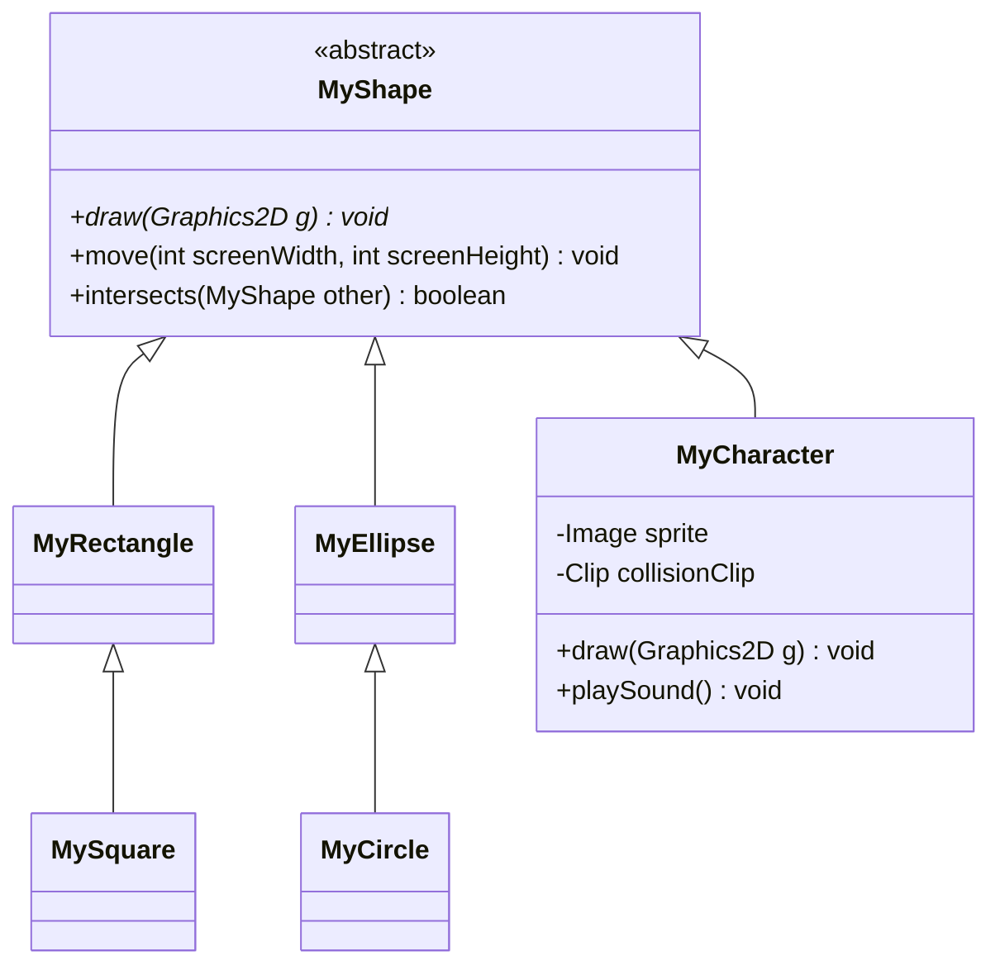

# Arquitetura de referência

Planejada; ainda sem implementação Java neste repositório.

App inicializa Swing na EDT. ScreenSaver mantém janela, painel, entrada e loop. O modelo contém as entidades. Uma List<MyShape> permite desenhar formas e personagem por polimorfismo. Este diagrama resume a hierarquia; o documento do professor define a lista completa de atributos, construtores e métodos.
